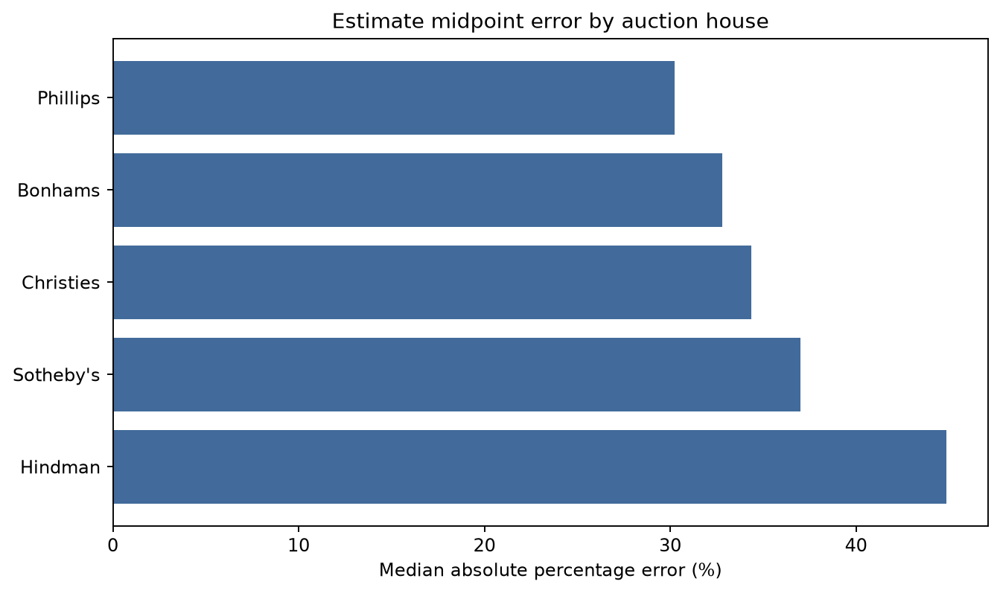
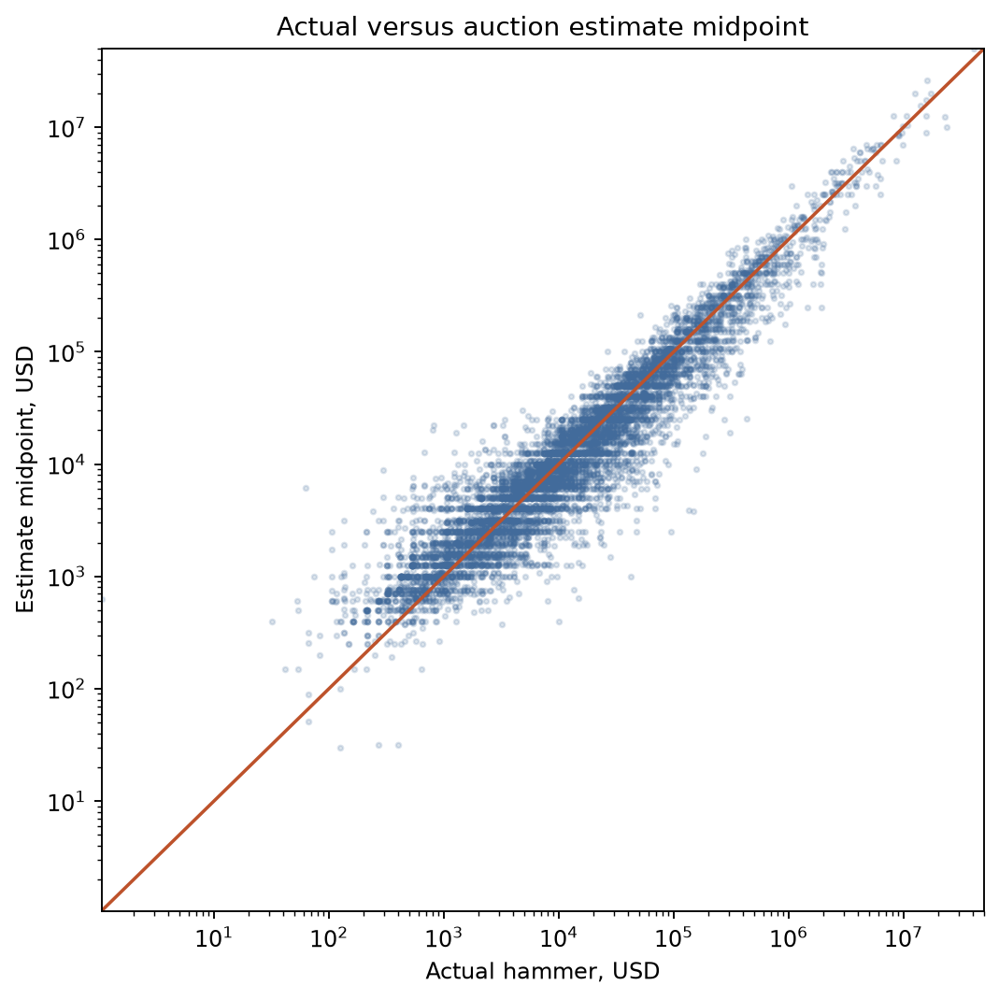
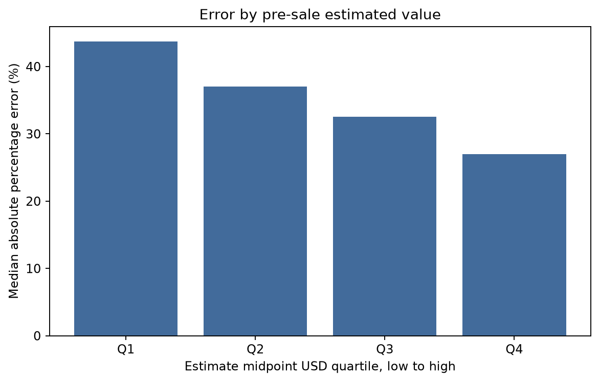
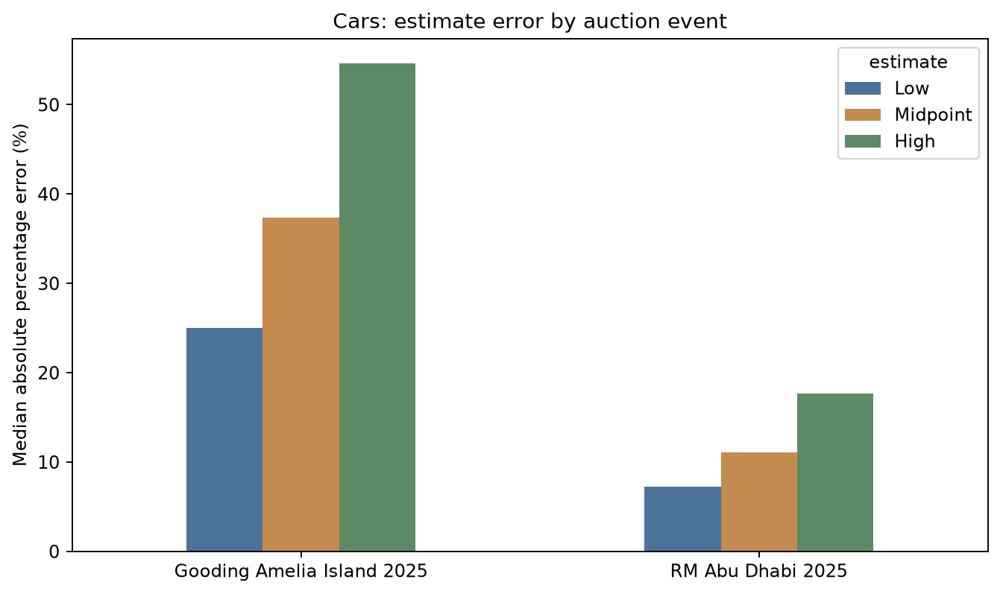
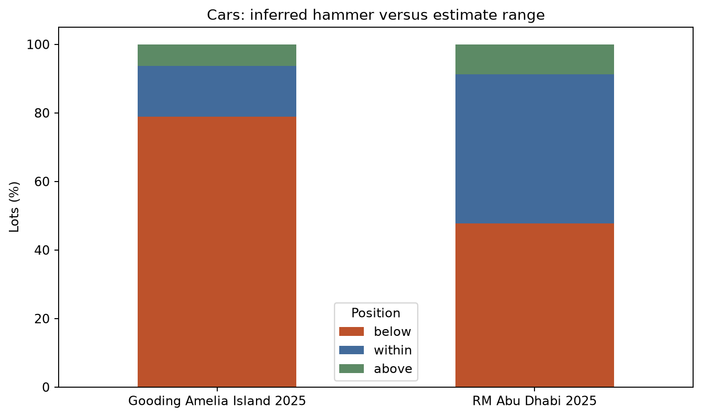

# Daily Pricing V2 Comparisons

This repository contains the complete normal-versus-V2 auction-data comparison and Daily Pricing rerun for Artwork, Cars, and Memorabilia.

The main project folder is [V2Comparisons](V2Comparisons/). Its README explains the workflow, matching decisions, data-quality findings, final results, charts, generated tables, and remaining model-data requirements.

## Start here

- [Project README and full workflow](V2Comparisons/README.md)
- [Final consolidated report](V2Comparisons/Report/final_daily_pricing_analysis_report.md)
- [Final rerun summary](V2Comparisons/Report/DailyPricing_Rerun_2026-11-15/rerun_summary.md)

## Assets

- [Artwork comparison data and reports](V2Comparisons/Artworks/)
- [Cars comparison data and reports](V2Comparisons/Cars/)
- [Memorabilia comparison data and reports](V2Comparisons/Memorabilia/)
- [Merged daily inputs](V2Comparisons/Combined/)
- [CSV exports](V2Comparisons/Output/)
- [Reports and charts](V2Comparisons/Report/)

## Final rerun results

| Asset | Source rows | Analysis lots | Low estimate median APE | Midpoint median APE | High estimate median APE |
|---|---:|---:|---:|---:|---:|
| Artwork | 139,442 | 18,967 | 32.89% | 34.38% | 41.73% |
| Cars | 12,531 | 151 | Event-specific | Gooding 37.38%; RM Abu Dhabi 11.11% | Event-specific |
| Memorabilia | 7,858 | 883 | 22.08% | 39.21% | 60.00% |

APE means median absolute percentage error; lower is better. Cars are reported by auction event because the available sample is limited and buyer-premium inversion is event-specific.

## Key findings

- The low estimate performed better than the midpoint and high estimate for Artwork and Memorabilia.
- Artwork produced the largest analysis population: 18,967 lots.
- Cars produced 151 usable lots, split between Gooding Amelia Island and RM Abu Dhabi.
- Memorabilia produced 883 matched lots, with Sports items dominating the sample.
- Sothebys Memorabilia had substantial V2 changes, especially in realized prices and USD realized prices.
- Hindman and SCP Auction had no selected-field differences between normal and V2.
- Goldin and Mathewsons Memorabilia had no V2 JSON output available.
- No Barkr, Local Pricer, Standard, or Llama prediction files were supplied, so model-to-model accuracy was not calculated.

## Charts and graphs

### Artwork

### Cars

### Additional chart files

The complete chart set is available in the [Artwork report folder](V2Comparisons/Report/DailyPricing_Rerun_2026-11-15/Artwork/), [Cars report folder](V2Comparisons/Report/DailyPricing_Rerun_2026-11-15/Cars/), and [Memorabilia report folder](V2Comparisons/Report/DailyPricing_Rerun_2026-11-15/Memorabilia/).

## Full findings and workflow

- [Final consolidated report](V2Comparisons/Report/final_daily_pricing_analysis_report.md)
- [Final rerun summary](V2Comparisons/Report/DailyPricing_Rerun_2026-11-15/rerun_summary.md)
- [Detailed project workflow and decisions](V2Comparisons/README.md)
