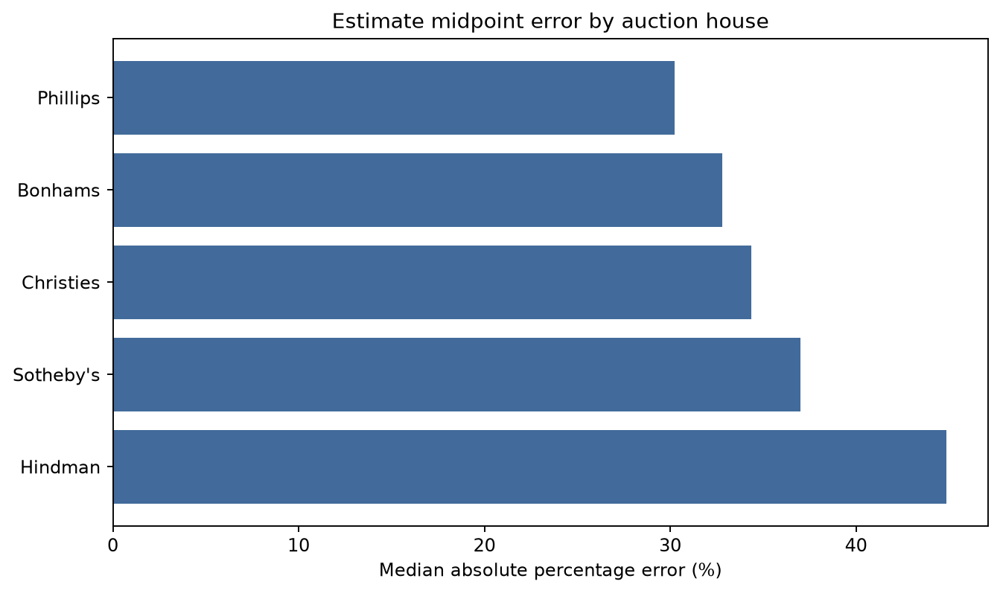
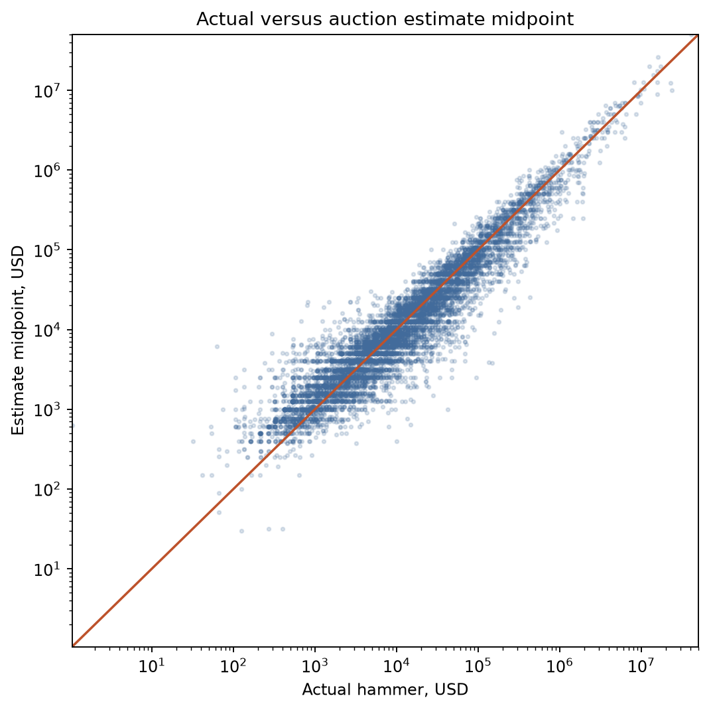
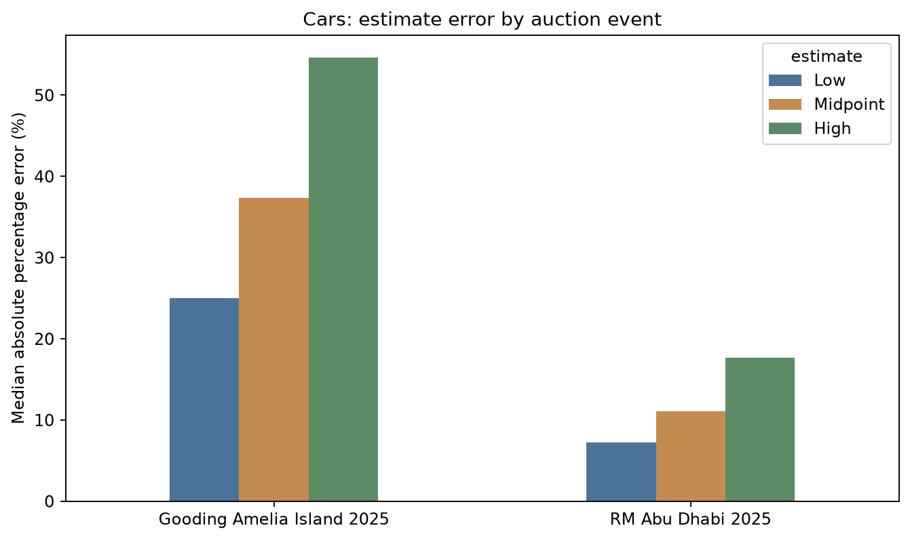

# Daily Pricing V2 Comparisons

This repository contains the normal-versus-V2 comparison work and the rerun of the Daily Pricing Analysis for Artwork, Cars, and Memorabilia.

## What this project answers

The analysis compares, for each asset and auction house:

1. Normal JSON files versus their matching `_v2.json` files.
2. JSON row populations and file coverage.
3. Stable record matches, primarily by `lot_url`.
4. Changes in descriptions, estimates, realized prices, titles, and related fields.
5. JSON outputs against the matching CSV exports.
6. Auction-house estimate performance using the merged daily datasets.

The project does not claim model accuracy for Barkr, Local Pricer, Standard, or Llama because item-level prediction files were not present in the supplied data.

## Repository structure

```text
V2Comparisons/
├── Artworks/          # Normal and V2 Artwork JSON files by auction house
├── Cars/              # Normal and V2 Cars JSON files by auction house
├── Memorabilia/       # Normal and V2 Memorabilia JSON files by auction house
├── Combined/          # Merged daily JSON inputs used for the final rerun
├── Output/            # CSV exports organized by date, auction house, and asset
└── Report/
    ├── <Asset>/<AuctionHouse>/findings_report.md
    ├── DailyPricing_Rerun_2026-11-15/
    └── final_daily_pricing_analysis_report.md
```

## Workflow used

### 1. Organize the source data

Data was arranged as:

```text
V2Comparisons/<Asset>/<AuctionHouse>/
```

Normal JSON files and their V2 counterparts were identified by filename stem. For example:

```text
standardized_bonhams_data_4AR.json
standardized_bonhams_data_4AR_v2.json
```

Empty auction-house folders were retained and documented as no-data units.

### 2. Compare file coverage

For every auction house, the following were recorded:

- Normal JSON file count.
- V2 JSON file count.
- Paired, normal-only, and V2-only stems.
- Normal and V2 row counts.
- Row-count mismatches.
- Matching CSV file count and row count.

### 3. Match records

`lot_url` was used as the primary stable key. Where V2 lacked `lot_url`, a documented fallback was used:

- Freemans Memorabilia: title-based matching was used because V2 had no lot URLs.
- Matched records and unmatched records were reported separately.
- Generated IDs were not treated as reliable cross-version keys when they changed between files.

### 4. Compare fields

The main comparison fields were:

- `description_block`
- `ah_low_estimate`
- `ah_high_estimate`
- `ah_price`
- `ah_price_usd`
- `title`
- `model` where applicable

### 5. Create auction-house reports

Each unit received a report at:

```text
Report/<Asset>/<AuctionHouse>/findings_report.md
```

The report records coverage, matching methodology, changes, data-quality issues, and the decision for the pricing rerun.

### 6. Rerun daily pricing analysis

After the auction-house comparisons were complete, the merged files in `Combined/` were used as the final inputs. The regenerated outputs are under:

```text
Report/DailyPricing_Rerun_2026-11-15/
```

The rerun contains CSV summaries, data-quality tables, outlier lists, and charts for each asset.

## Final rerun results

| Asset | Combined source rows | Analysis lots | Low estimate median APE | Midpoint median APE | High estimate median APE |
|---|---:|---:|---:|---:|---:|
| Artwork | 139,442 | 18,967 | 32.89% | 34.38% | 41.73% |
| Cars | 12,531 | 151 | Event-specific | Gooding 37.38%; RM Abu Dhabi 11.11% | Event-specific |
| Memorabilia | 7,858 | 883 | 22.08% | 39.21% | 60.00% |

APE means median absolute percentage error. Lower is better. Cars are reported by event because the available sample is limited and the sold-price basis requires event-specific buyer-premium inversion.

## Main findings

### Artwork

Artwork produced 18,967 eligible analysis lots. The low estimate had the lowest median absolute percentage error at 32.89%, followed by the midpoint at 34.38% and the high estimate at 41.73%. The analysis includes house, medium, estimated-value-band, sale-quarter, range-position, and outlier tables.






### Cars

Cars produced 151 eligible analysis lots. Gooding Amelia Island 2025 had a midpoint median absolute percentage error of 37.38% across 128 lots. RM Abu Dhabi 2025 had 11.11% across 23 lots. These figures must not be generalized to all car auctions because the sample is event-limited.




### Memorabilia

Memorabilia produced 883 eligible matched lots. The low estimate had the lowest median absolute percentage error at 22.08%, the midpoint was 39.21%, and the high estimate was 60.00%. Sports items dominated the matched sample, so house and type comparisons should be interpreted with coverage and mix in mind.

The combined Memorabilia input did not require currency inference for the final matched sample. The rerun included house, type, sport, estimate-band, quarter, coverage, dollar-error, and outlier tables.

## Key decisions and rationale

| Decision | Rationale |
|---|---|
| Use `lot_url` as the primary match key | IDs were regenerated or changed between normal and V2 files in several sources. |
| Use title fallback only when necessary | Freemans V2 records lacked lot URLs; the fallback is documented and should be validated. |
| Keep empty auction-house folders | An empty folder is a valid coverage result and prevents confusing missing data with unprocessed data. |
| Separate normal-only and V2-only stems | A file cannot be treated as a revision comparison when its counterpart is absent. |
| Report row mismatches explicitly | Equal file names do not guarantee equal record populations. |
| Exclude misplaced files from house-specific counts | For example, `Bonhams_Cars` exports were not counted as `Bonhams` outputs. |
| Analyze Cars by event | Buyer-premium schedules and sample sizes differ materially by event. |
| Do not infer model accuracy | No item-level Barkr, Local Pricer, Standard, or Llama predictions were supplied. |
| Preserve previous reports | New rerun outputs were written to a dated folder instead of overwriting the previous `daily_sales` reports. |

## Important data-quality findings

- Some auction houses have missing V2 files.
- Some file stems are normal-only or V2-only.
- Some paired files have different row counts.
- Freemans V2 lacks `lot_url`, requiring title matching.
- Goldin has normal JSON and CSV data but no V2 JSON.
- Mathewsons Memorabilia has normal JSON and CSV data but no V2 JSON.
- Mathewsons and Goldin folders contained files belonging to another source and those files were excluded from their house-specific analysis.
- The final merged outputs are suitable for the documented benchmark rerun, but unmatched and mismatched populations should be resolved before external publication.

## Output guide

### Comparison reports

Open the individual report for the relevant asset and auction house:

```text
Report/<Asset>/<AuctionHouse>/findings_report.md
```

### Final rerun summary

- [Rerun summary](Report/DailyPricing_Rerun_2026-11-15/rerun_summary.md)
- [Final consolidated report](Report/final_daily_pricing_analysis_report.md)

### Rerun tables

- Artwork: `Report/DailyPricing_Rerun_2026-11-15/Artwork/`
- Cars: `Report/DailyPricing_Rerun_2026-11-15/Cars/`
- Memorabilia: `Report/DailyPricing_Rerun_2026-11-15/Memorabilia/`

## What is still needed for model comparison

To compare Barkr, Local Pricer, Standard, and Llama, provide an item-level prediction table containing:

- `lot_url` or another stable lot key.
- `asset_type`.
- `method`.
- `prediction`.
- `currency`.
- `price_basis` such as `hammer` or `premium_inclusive`.
- `run_timestamp`.
- `prediction_available`.

The prediction table should be joined to the same eligible lots, with one documented prediction per method and lot, preferably the latest valid prediction before the sale. Report both coverage and paired accuracy by asset, auction house, subtype, value band, and time period.

## Reproducibility

The original analysis logic is in the workspace `daily_sales` scripts. The final rerun used the same logic against the merged JSON files in `Combined/` and wrote dated outputs under `Report/DailyPricing_Rerun_2026-11-15/`.
