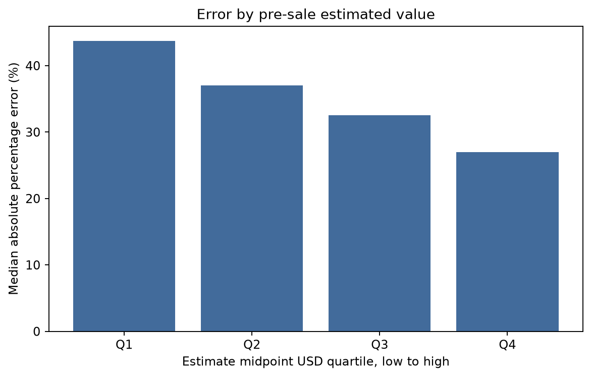
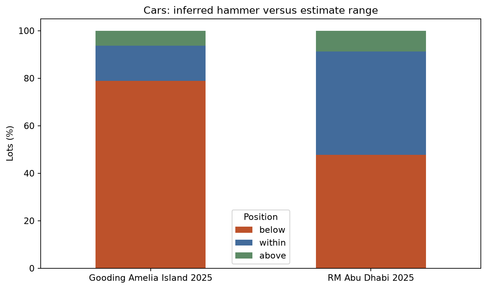

# Daily Pricing V2 Comparisons

This repository contains the normal-versus-V2 comparison work and the rerun of the Daily Pricing Analysis for Artwork, Cars, and Memorabilia.

## What this project answers

The analysis compares, for each asset and auction house:

1. Normal JSON files versus their matching `_v2.json` files.
2. JSON row populations and file coverage.
3. Stable record matches, primarily by `lot_url`.
4. Changes in descriptions, estimates, realized prices, titles, and related fields.
5. JSON outputs against the matching CSV exports.
6. Auction-house estimate performance using the merged daily datasets.

The project does not claim model accuracy for Barkr, Local Pricer, Standard, or Llama because item-level prediction files were not present in the supplied data.

## Comparison register and source sheet

The working register for this project is the Google Sheet [V2 Comparebles](https://docs.google.com/spreadsheets/d/1Fq3_2o6asHOzoGQFeUtw4fC5I9eN5sR_sm_1kK6hHOI/edit?gid=0#gid=0). It contains the asset, auction house, normal/V2/CSV file counts, paired and unmatched file counts, row counts, mismatch counts, key findings, report path, and completion status. The Markdown reports and rerun outputs in this repository are the detailed evidence behind that register.

The work was completed in this order: Artwork auction house by auction house, then Cars, then Memorabilia. Empty folders were retained and recorded as completed no-data units so that missing data is distinguishable from unfinished analysis.

## Repository structure

```text
V2Comparisons/
├── Artworks/          # Normal and V2 Artwork JSON files by auction house
├── Cars/              # Normal and V2 Cars JSON files by auction house
├── Memorabilia/       # Normal and V2 Memorabilia JSON files by auction house
├── Combined/          # Merged daily JSON inputs used for the final rerun
├── Output/            # CSV exports organized by date, auction house, and asset
└── Report/
    ├── <Asset>/<AuctionHouse>/findings_report.md
    ├── DailyPricing_Rerun_2026-11-15/
    └── final_daily_pricing_analysis_report.md
```

## Workflow used

### 1. Organize the source data

Data was arranged as:

```text
V2Comparisons/<Asset>/<AuctionHouse>/
```

Normal JSON files and their V2 counterparts were identified by filename stem. For example:

```text
standardized_bonhams_data_4AR.json
standardized_bonhams_data_4AR_v2.json
```

Empty auction-house folders were retained and documented as no-data units.

### 2. Compare file coverage

For every auction house, the following were recorded:

- Normal JSON file count.
- V2 JSON file count.
- Paired, normal-only, and V2-only stems.
- Normal and V2 row counts.
- Row-count mismatches.
- Matching CSV file count and row count.

### 3. Match records

`lot_url` was used as the primary stable key. Where V2 lacked `lot_url`, a documented fallback was used:

- Freemans Memorabilia: title-based matching was used because V2 had no lot URLs.
- Matched records and unmatched records were reported separately.
- Generated IDs were not treated as reliable cross-version keys when they changed between files.

### 4. Compare fields

The main comparison fields were:

- `description_block`
- `ah_low_estimate`
- `ah_high_estimate`
- `ah_price`
- `ah_price_usd`
- `title`
- `model` where applicable

### 5. Create auction-house reports

Each unit received a report at:

```text
Report/<Asset>/<AuctionHouse>/findings_report.md
```

The report records coverage, matching methodology, changes, data-quality issues, and the decision for the pricing rerun.

### 6. Rerun daily pricing analysis

After the auction-house comparisons were complete, the merged files in `Combined/` were used as the final inputs. The regenerated outputs are under:

```text
Report/DailyPricing_Rerun_2026-11-15/
```

The rerun contains CSV summaries, data-quality tables, outlier lists, and charts for each asset.

## Final rerun results

| Asset | Combined source rows | Analysis lots | Low estimate median APE | Midpoint median APE | High estimate median APE |
|---|---:|---:|---:|---:|---:|
| Artwork | 139,442 | 18,967 | 32.89% | 34.38% | 41.73% |
| Cars | 12,531 | 151 | Event-specific | Gooding 37.38%; RM Abu Dhabi 11.11% | Event-specific |
| Memorabilia | 7,858 | 883 | 22.08% | 39.21% | 60.00% |

APE means median absolute percentage error. Lower is better. Cars are reported by event because the available sample is limited and the sold-price basis requires event-specific buyer-premium inversion.

## Main findings

### Artwork

Artwork produced 18,967 eligible analysis lots. The low estimate had the lowest median absolute percentage error at 32.89%, followed by the midpoint at 34.38% and the high estimate at 41.73%. The analysis includes house, medium, estimated-value-band, sale-quarter, range-position, and outlier tables.




### Cars

Cars produced 151 eligible analysis lots. Gooding Amelia Island 2025 had a midpoint median absolute percentage error of 37.38% across 128 lots. RM Abu Dhabi 2025 had 11.11% across 23 lots. These figures must not be generalized to all car auctions because the sample is event-limited.




### Memorabilia

Memorabilia produced 883 eligible matched lots. The low estimate had the lowest median absolute percentage error at 22.08%, the midpoint was 39.21%, and the high estimate was 60.00%. Sports items dominated the matched sample, so house and type comparisons should be interpreted with coverage and mix in mind.

The combined Memorabilia input did not require currency inference for the final matched sample. The rerun included house, type, sport, estimate-band, quarter, coverage, dollar-error, and outlier tables.

## Complete auction-house findings register

The following is the repository-readable summary of the Google Sheet register. For the full counts and row-level details, use the linked sheet and the individual report in the last column.

| Asset | Auction house | Coverage and result | Main finding / decision | Detailed report |
|---|---|---|---|---|
| Artwork | Bonhams | 210 normal, 196 V2, 182 paired; 25,543 vs 23,749 rows; 16 CSVs | V2 differs in coverage, row counts, schema, descriptive fields, and realized prices. Normalize IDs, numeric values, and nulls before pricing comparison. | [Report](Report/Artworks/Bonhams/findings_report.md) |
| Artwork | Christies | 224 normal, 235 V2, 200 paired; 24,147 vs 26,688 rows; 28 CSVs | Use `lot_url` as the stable key. Major changes are in subject matter, realized prices, and hammer price. | [Report](Report/Artworks/Christies/findings_report.md) |
| Artwork | Freemans | 19 normal, 10 V2, 7 paired; 3,139 vs 823 rows; no CSV | V2 coverage is incomplete. Of 375 matched records, 296 changed, mainly in subject matter. No Freemans Artwork CSV export was available. | [Report](Report/Artworks/Freemans/findings_report.md) |
| Artwork | Hindman | 42 normal, 41 V2, 38 paired; 5,811 vs 5,177 rows; 1 CSV | Near-complete coverage but fewer V2 rows. 4,047 of 4,350 common records changed, led by hammer price, realized price, and subject matter. | [Report](Report/Artworks/Hindman/findings_report.md) |
| Artwork | Phillips | 86 normal, 95 V2, 71 paired; 10,387 vs 12,127 rows; 5 CSVs | V2 has more coverage and rows. 7,471 of 8,578 common records changed, led by hammer price, realized price, subject matter, and medium. | [Report](Report/Artworks/Phillips/findings_report.md) |
| Artwork | Sothebys | 234 normal, 235 V2, 221 paired; 21,359 vs 22,157 rows; 22 CSVs | V2 has slightly more coverage and rows. 15,651 of 18,533 common records changed, led by realized price, hammer price, subject matter, and description. | [Report](Report/Artworks/Sothebys/findings_report.md) |
| Cars | AutoHunter_Classic | No normal JSON, V2 JSON, or CSV | No comparison or daily-pricing analysis was applicable; folder retained as a documented no-data unit. | [Report](Report/Cars/AutoHunter_Classic/findings_report.md) |
| Cars | Bonhams | No data in the Bonhams folder | The downloaded car data is stored separately under `Bonhams_Cars`; it was not counted as Bonhams. | [Report](Report/Cars/Bonhams/findings_report.md) |
| Cars | Bonhams_Cars | 13 normal, 15 V2, 8 paired; 1,666 vs 1,768 rows; 5 CSVs | V2 has asymmetric coverage and 102 more rows. 159 of 423 common records changed mainly in descriptions, realized prices, URLs, estimates, and titles. | [Report](Report/Cars/Bonhams_Cars/findings_report.md) |
| Cars | Bring_A_Trailer | No normal JSON, V2 JSON, or CSV | No comparison or daily-pricing analysis was applicable. | [Report](Report/Cars/Bring_A_Trailer/findings_report.md) |
| Cars | Broad_Arrow | 8 normal, 8 V2, 6 paired; 692 vs 705 rows; 9 CSVs | V2 has 13 more rows. 368 of 369 common records changed mainly in descriptions and estimates; CSV output includes a duplicate stem across months. | [Report](Report/Cars/Broad_Arrow/findings_report.md) |
| Cars | Classic_Trader | No normal JSON, V2 JSON, or CSV | Local folder is empty; no comparison or daily-pricing analysis was applicable. | [Report](Report/Cars/Classic_Trader/findings_report.md) |
| Cars | Dyler | No normal JSON, V2 JSON, or CSV | Local folder is empty; no comparison or daily-pricing analysis was applicable. | [Report](Report/Cars/Dyler/findings_report.md) |
| Cars | Gooding_Co | 3 normal, 1 V2, 1 paired; 398 vs 133 rows; 6 CSVs | Paired 4D data is identical for 133 records with no selected-field changes. CSV output has six exports across three stems. | [Report](Report/Cars/Gooding_Co/findings_report.md) |
| Cars | Mathewsons | 1 normal, 3 V2, 1 paired; 900 vs 811 rows; 1 CSV | Paired 1B has 900 normal vs 599 V2 rows but zero shared URLs/IDs. V2-only files add 212 rows; direct record comparison is not possible. | [Report](Report/Cars/Mathewsons/findings_report.md) |
| Cars | Mecum | 7 normal, 3 V2, 1 paired; 4,301 vs 1,734 rows; 3 CSVs | Paired 4D has 40 common records with no selected-field changes, but 68 normal vs 40 V2 rows. Six normal-only and two V2-only files remain. | [Report](Report/Cars/Mecum/findings_report.md) |
| Memorabilia | Bonhams | 3 normal, 3 V2, 3 paired; 362 vs 362 rows; 5 CSVs | All 362 paired records matched by `lot_url`. Changes are concentrated in estimates and seven titles; realized prices were unchanged. | [Report](Report/Memorabilia/Bonhams/findings_report.md) |
| Memorabilia | Broad_Arrow | 2 normal, 1 V2, no paired stem; 388 vs 197 rows; 2 CSVs | No normal/V2 pair exists. Normal 4N/4O have matching CSVs; V2-only 4I has no matching CSV export. | [Report](Report/Memorabilia/Broad_Arrow/findings_report.md) |
| Memorabilia | Christies | 8 normal, 7 V2, 7 paired; 837 vs 787 rows; 6 CSVs | 757 paired records matched by `lot_url`, with 485 selected-field changes, including 284 sale-price changes. Three pairs have row mismatches. | [Report](Report/Memorabilia/Christies/findings_report.md) |
| Memorabilia | Freemans | 1 normal, 1 V2, 1 paired; 412 vs 412 rows; 1 CSV | V2 lacks `lot_url`. Title fallback matched 385 records and found 1,492 selected-field changes, including 361 sale-price changes. | [Report](Report/Memorabilia/Freemans/findings_report.md) |
| Memorabilia | Goldin | 1 normal, no V2; 383 vs 0 rows; 1 CSV | No V2 JSON was available. The normal JSON and CSV each contain 383 rows; two misplaced Freemans files were excluded. | [Report](Report/Memorabilia/Goldin/findings_report.md) |
| Memorabilia | Hindman | 2 normal, 2 V2, 2 paired; 715 vs 715 rows; 2 CSVs | All 715 records matched by `lot_url`; no selected-field differences were found. | [Report](Report/Memorabilia/Hindman/findings_report.md) |
| Memorabilia | Mathewsons | 2 normal, no V2; 1,779 vs 0 rows; 1 CSV | No V2 JSON was available. The CSV has 879 rows and corresponds to the 4F normal file. | [Report](Report/Memorabilia/Mathewsons/findings_report.md) |
| Memorabilia | SCP_Auction | 1 normal, 1 V2, 1 paired; 519 vs 519 rows; 1 CSV | All 519 records matched by `lot_url` with no selected-field differences. No V2-driven pricing changes are required. | [Report](Report/Memorabilia/SCP_Auction/findings_report.md) |
| Memorabilia | Sothebys | 33 normal, 30 V2, 27 paired; 3,005 vs 2,479 rows; 40 CSVs | 1,910 paired records matched by `lot_url`, with 4,146 selected-field changes, including 1,792 sale-price changes. Nine pairs have row mismatches. | [Report](Report/Memorabilia/Sothebys/findings_report.md) |

### How to read the register

- **Normal/V2 files** are the downloaded JSON outputs before and after the V2 comparison changes.
- **Paired** means the normal and V2 filename stems were both present; normal-only and V2-only stems were kept separate.
- **Rows** are the total JSON rows in the corresponding asset/auction-house folders, not necessarily unique lots.
- **CSV counts and rows** refer to the available daily-pricing CSV exports and are used as a separate validation/comparison source.
- A completed no-data row is an intentional result, not an error: it means the expected source files were not available in that auction-house folder.

## Key decisions and rationale

| Decision | Rationale |
|---|---|
| Use `lot_url` as the primary match key | IDs were regenerated or changed between normal and V2 files in several sources. |
| Use title fallback only when necessary | Freemans V2 records lacked lot URLs; the fallback is documented and should be validated. |
| Keep empty auction-house folders | An empty folder is a valid coverage result and prevents confusing missing data with unprocessed data. |
| Separate normal-only and V2-only stems | A file cannot be treated as a revision comparison when its counterpart is absent. |
| Report row mismatches explicitly | Equal file names do not guarantee equal record populations. |
| Exclude misplaced files from house-specific counts | For example, `Bonhams_Cars` exports were not counted as `Bonhams` outputs. |
| Analyze Cars by event | Buyer-premium schedules and sample sizes differ materially by event. |
| Do not infer model accuracy | No item-level Barkr, Local Pricer, Standard, or Llama predictions were supplied. |
| Preserve previous reports | New rerun outputs were written to a dated folder instead of overwriting the previous `daily_sales` reports. |

## Important data-quality findings

- Some auction houses have missing V2 files.
- Some file stems are normal-only or V2-only.
- Some paired files have different row counts.
- Freemans V2 lacks `lot_url`, requiring title matching.
- Goldin has normal JSON and CSV data but no V2 JSON.
- Mathewsons Memorabilia has normal JSON and CSV data but no V2 JSON.
- Mathewsons and Goldin folders contained files belonging to another source and those files were excluded from their house-specific analysis.
- The final merged outputs are suitable for the documented benchmark rerun, but unmatched and mismatched populations should be resolved before external publication.

## Output guide

### Comparison reports

Open the individual report for the relevant asset and auction house:

```text
Report/<Asset>/<AuctionHouse>/findings_report.md
```

### Final rerun summary

- [Rerun summary](Report/DailyPricing_Rerun_2026-11-15/rerun_summary.md)
- [Final consolidated report](Report/final_daily_pricing_analysis_report.md)

### Rerun tables

- Artwork: `Report/DailyPricing_Rerun_2026-11-15/Artwork/`
- Cars: `Report/DailyPricing_Rerun_2026-11-15/Cars/`
- Memorabilia: `Report/DailyPricing_Rerun_2026-11-15/Memorabilia/`

### Charts and graphs

The rerun charts are embedded above and stored with the outputs so they can be viewed independently:

- Artwork: `01_hammer_distribution.png`, `02_actual_vs_midpoint.png`, `03_range_position.png`, `04_house_error.png`, `05_estimated_value_error.png`, and `06_quarter_error.png`.
- Cars: `01_estimate_error_by_event.png` and `02_range_position_by_event.png`.
- Memorabilia: the CSV summary tables under `Report/DailyPricing_Rerun_2026-11-15/Memorabilia/` provide the house, type, sport, estimate-band, quarter, coverage, dollar-error, and outlier breakdowns; no image chart was generated for this asset in the rerun package.

## What is still needed for model comparison

To compare Barkr, Local Pricer, Standard, and Llama, provide an item-level prediction table containing:

- `lot_url` or another stable lot key.
- `asset_type`.
- `method`.
- `prediction`.
- `currency`.
- `price_basis` such as `hammer` or `premium_inclusive`.
- `run_timestamp`.
- `prediction_available`.

The prediction table should be joined to the same eligible lots, with one documented prediction per method and lot, preferably the latest valid prediction before the sale. Report both coverage and paired accuracy by asset, auction house, subtype, value band, and time period.

## Reproducibility

The original analysis logic is in the workspace `daily_sales` scripts. The final rerun used the same logic against the merged JSON files in `Combined/` and wrote dated outputs under `Report/DailyPricing_Rerun_2026-11-15/`.
